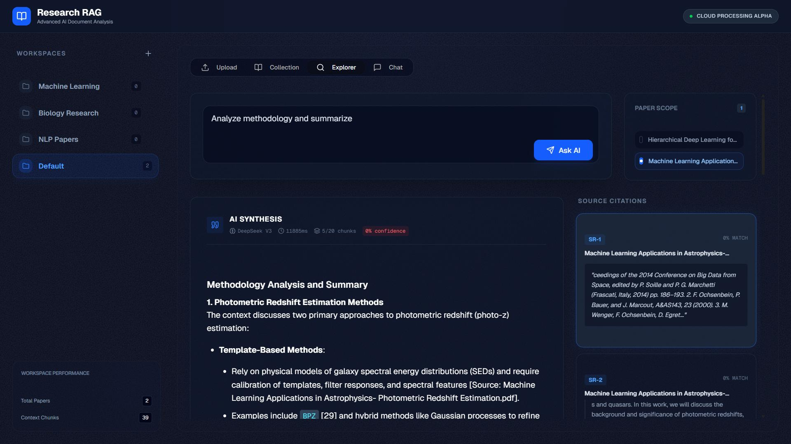

<!-- ================================================= -->
<!--              CHANDAN KUMAR - README              -->
<!-- ================================================= -->

<div align="center">

<a href="https://github.com/Chandan-kumar10">

</a>


<br/>

<a href="https://github.com/Chandan-kumar10">

</a>
<a href="https://www.linkedin.com/in/chandankumar-cse">

</a>
<a href="mailto:chandanlaheri590@gmail.com">

</a>

<br/><br/>


</div>

---

## `whoami` 👨‍💻

```bash
$ whoami

Chandan Kumar
Software Developer | Computer Science Undergraduate
Greater Noida, Uttar Pradesh, India
```

I'm a Computer Science undergraduate specializing in Cybersecurity at Galgotias University (2023–2027).

I enjoy building practical software applications, solving programming problems and exploring how technology works behind the scenes.

My primary interests are Java development, backend engineering, cybersecurity and emerging AI technologies.

```python
developer = {
    "name": "Chandan Kumar",
    "education": "B.Tech CSE (Cybersecurity)",
    "university": "Galgotias University",
    "graduation": 2027,

    "interests": [
        "Software Development",
        "Backend Engineering",
        "Cybersecurity",
        "Artificial Intelligence"
    ],

    "currently_learning": [
        "Java & Spring Boot",
        "Data Structures & Algorithms",
        "Generative AI",
        "Retrieval-Augmented Generation"
    ],

    "mindset": "Learn, Build, Improve"
}
```

## `tech_stack` 🧰

### Programming Languages

<p>

</p>

### Backend & Web Development

<p>

</p>

### Developer Tools

<p>

</p>

### Core Computer Science

- Object-Oriented Programming (OOP)
- Data Structures & Algorithms
- Database Management Systems
- Computer Networks
- Operating Systems

### AI & Cybersecurity

- Generative AI and Large Language Models
- Retrieval-Augmented Generation (RAG)
- Network Scanning Fundamentals
- Phishing Detection and Analysis
- GoPhish and Mailtrap

---

## `experience` 💼

### Cyber Security Intern

**Digi Suraksha Prahari Foundation**

`July 2025 – September 2025` | Virtual

- Analyzed phishing and legitimate email datasets.
- Identified suspicious URLs, sender patterns and phishing indicators.
- Worked with GoPhish and Mailtrap for phishing simulation.
- Collaborated with a team of three members.

---


## 🚀 Featured Projects

### 01. Web-Based Network Port Scanner

<p align="center">
  
</p>

**Java | Spring Boot | HTML | CSS | JavaScript**

A web-based network scanning application with port detection, service identification and risk classification.

---

### 02. RAG-Based Academic Research Assistant

<p align="center">
  
</p>

**Python | LLM | RAG | Generative AI**

An academic research assistant focused on document retrieval, grounded answers and citations.

---

### 03. Java DSA Practice

<p align="center">
  
</p>

**Java | DSA | Problem Solving**

A coding practice project focused on algorithms and problem-solving.


## `education` 🎓

**Galgotias University**

B.Tech — Computer Science and Engineering (Cybersecurity)

`2023 – 2027`

**Relevant Coursework**
- Data Structures & Algorithms
- Database Management Systems
- Computer Networks
- Operating Systems
- Cybersecurity Fundamentals

---

## `achievements` 🏆

- Top 150 Teams — SRM Hackathon.
- Volunteer — CyberPeace Summit 2026.
- Participated in hackathons at IIT Delhi, NSUT and SRM.
- Participated in HackMatrix DSA Coding Contest.

---

## `github_activity` 📊

<div align="center">


<br/>


</div>

---

## `currently_working_on` ⚡

```bash
[+] Improving Java and Spring Boot skills
[+] Practicing DSA for technical interviews
[+] Exploring AI / ML engineering
[+] Researching RAG-based applications
[+] Building practical development projects
```

## `connect_with_me` 🌐

<p align="center">

<a href="https://github.com/Chandan-kumar10">

</a>

<a href="https://www.linkedin.com/in/chandankumar-cse">

</a>

<a href="mailto:YOUR_EMAIL">

</a>

</p>

<div align="center">

### `$ echo "Thanks for visiting my profile!"`


</div>
